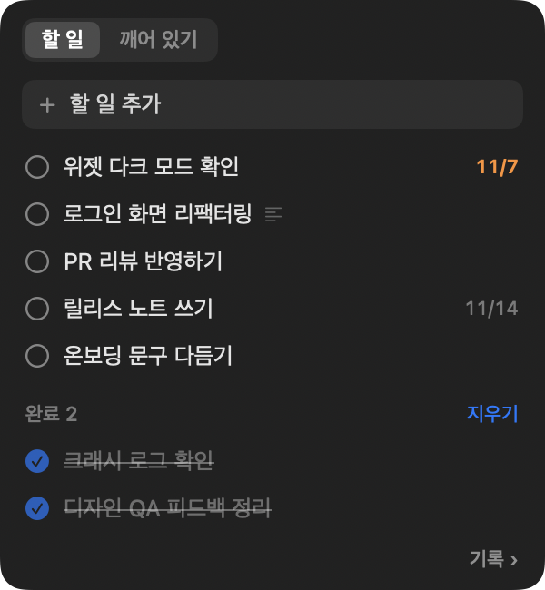
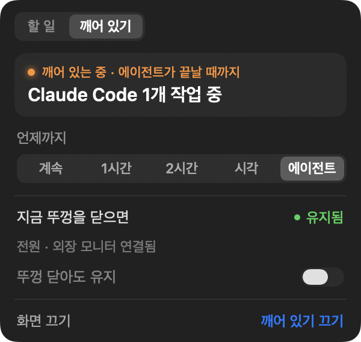
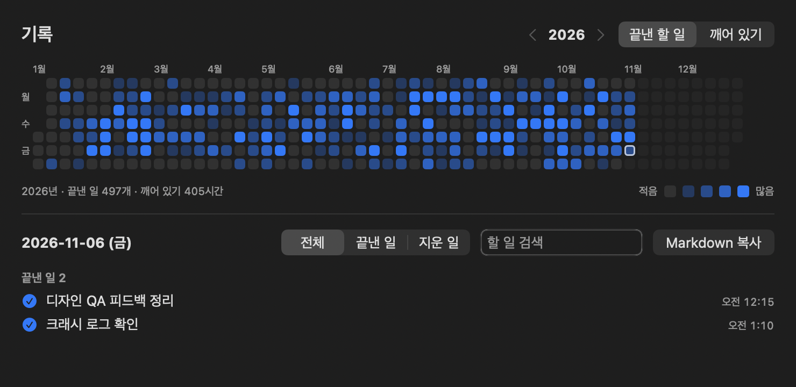

<p align="center">
  
</p>

<h1 align="center">Lantern</h1>

<p align="center"><b>English</b> · <a href="README.md">한국어</a></p>

<p align="center">
  Your to-dos always in view. Your Mac awake until the work is done.<br>
  A macOS utility that keeps a to-do list floating in the corner of your screen and keeps your Mac awake while Claude Code or Codex works — or until a time you choose.
</p>

<p align="center">
  
</p>

> **Note:** Lantern's interface is currently in Korean only. English is coming in the next version ([#2](https://github.com/SongKyuSeob/Lantern/issues/2)).

---

## Features

- **Keep Awake**: Stops your Mac from going to sleep for a set time, or until agents like Claude Code and Codex finish their work.
- **Closed-Lid Mode**: Keeps your Mac awake even with the lid closed and no external display. It turns itself off if the battery runs low or your Mac gets too hot.
- **Lid-close preview**: Shows whether your Mac would sleep or stay awake if you closed the lid right now.
- **To-dos**: Keeps your to-do list in a small window in the top-right corner. It's translucent, so it won't block your work, and clicks pass right through it.

<p align="center">
  
  &nbsp;
  
</p>

## Requirements

- macOS 26 or later
- A Mac with Apple silicon (M1 or later). Intel Macs aren't supported.
- Lantern goes online only to check for updates: once a day, it reads the latest version info from this repository's GitHub releases. Your to-dos, history, and usage data never leave your Mac. You can turn off update checks in Settings.

## Installation

1. Download the latest `Lantern-x.y.z.dmg` from [Releases](../../releases).
2. Open the dmg and drag **Lantern** to your **Applications** folder.
3. Open Lantern from Applications.

### If macOS says Lantern can't be opened

Lantern is a personal project and isn't signed with an Apple Developer ID yet, so macOS blocks it the first time you open it. You only need to allow it once:

1. Open Lantern. When macOS warns that it can't be opened or comes from an unidentified developer, click **Done** (or **Cancel**).
2. Go to **System Settings → Privacy & Security**.
3. Scroll down to **Security**. Next to "Lantern was blocked", click **Open Anyway**.
4. Enter your Mac password, then click **Open** when asked again.

> If you'd rather not, you can review the code in this repository and build Lantern yourself with Xcode.

> **Before you delete Lantern, read [Uninstalling](#uninstalling) first.** The Closed-Lid Mode permission (a system rule file) and agent connections stay on your Mac after the app is gone, so remove them in Settings beforehand.

### Updates

From 0.3.0 on, a small **● Version x.y.z available** appears in the top-right window when a new version is out (just a blue dot in single-line view). Open the window and click **Update to x.y.z** at the top to see what's new and install it. You can also check manually: right-click the menu bar icon and choose **Check for Updates…**, or go to **Settings → General**.

- Lantern never installs anything without asking. You always click Install yourself.
- Installing restarts Lantern, which ends any Keep Awake session, so Lantern asks first while you're awake. Choose **Install Later** to install automatically once the session ends.
- Updates are installed only after their signature is verified.
- **On 0.2.x?** That version can't update itself. Download the new dmg once and replace the app in Applications. Your to-dos, history, and settings are kept.

## Usage

### Menu bar icon

| Icon | Meaning |
|---|---|
| Outlined flame | Keep Awake is off |
| Filled flame | Awake |
| Flame between two pillars | Awake in Closed-Lid Mode |

- **Click**: Opens or closes the top-right window.
- **Right-click**: Opens the menu: start or stop Keep Awake, Until, Extend, Hide Window, Single-Line View, Show History, Check for Updates, Settings, and Quit.

> On MacBooks with a notch, menu bar space is tight, and the Lantern icon can end up hidden behind it. **Hold ⌘ and drag the icon to the right**, closer to the clock. Even when it's hidden, you can still open the window with the keyboard shortcut.

### The top-right window

The window comes in three forms:

- **Expanded window**: Appears when you click the icon or press the shortcut. This is where you manage your to-dos and Keep Awake. It closes when you click elsewhere, or 10 seconds after the pointer leaves it.
- **Summary window**: When the expanded window closes, a translucent summary stays on screen with your Keep Awake status and your top three to-dos.
- **Single-line view**: A one-line version of the summary window with just your Keep Awake status and how many to-dos you have.

<p align="center">
  
</p>

To switch single-line view on or off, right-click the menu bar icon and choose **Single-Line View**, or go to **Settings → General → Show summary window in a single line**. To move the window, **drag the tab bar** at the top of the expanded window to another corner or display; it snaps to the nearest corner when you let go, and opens upward from a bottom corner. Hover over the summary window and it fades so you can see what's behind it; clicks go straight through.

### Keyboard shortcuts

| Shortcut | Action |
|---|---|
| ⌃⌥L | Open or close the window (same as clicking the icon) |
| ⌃⌥⇧L | Hide or show the window |
| Esc | Close the expanded window |

You can change or turn off shortcuts in **Settings → General → Shortcuts**. Shortcuts must include **⌃ or ⌥**. Most apps already use ⌘ combinations like ⌘W and ⌘C, and claiming them as global shortcuts would break them everywhere.

### Keep Awake

In the **Awake** tab of the expanded window, pick an option under **Until** to start right away.

| Until | Keeps your Mac awake |
|---|---|
| Always | Until you turn it off |
| 1 Hour / 2 Hours | For that long, starting now |
| Time | Until the time you choose (tomorrow, if that time has already passed today) |
| Agents | Until your connected agents finish all their work (see [Connecting agents](#connecting-agents)) |

- **Extend ›**: Adds 30 minutes, 1 hour, or 2 hours to a timed session without starting over.
- **Turn Display Off**: Turns off the screen right away while your Mac stays awake.
- Keep Awake only stops your Mac from sleeping when it's left idle. Closing the lid still puts it to sleep, unless you also turn on **Closed-Lid Mode** below.
- On battery power, Keep Awake turns off when the battery drops below the **battery threshold** in Settings (20% by default).

### Closed-Lid Mode

Keeps your Mac awake when you close the lid without an external display. You can turn it on only while Keep Awake is on.

**It needs a one-time permission.** Go to **Settings → Power → Closed-Lid Mode**, click **Install…**, and enter your Mac password.

This adds a rule file (`/etc/sudoers.d/lantern`) that lets the following three commands run without a password, and nothing else:

```
sudo /usr/bin/pmset -a disablesleep 1   # prevent sleep
sudo /usr/bin/pmset -a disablesleep 0   # allow sleep again
sudo /usr/bin/pmset sleepnow            # sleep now
```

- **Other programs on your Mac can use this rule too**, but only to do these three things: keep your Mac awake or put it to sleep. Every other command still needs your password.
- You can remove the rule at any time with **Remove…** in the same place. **It isn't removed when you delete the app, so click Remove… before uninstalling Lantern.**

**Closed-Lid Mode turns off automatically when:**
- your Keep Awake session ends (if the lid is closed, your Mac goes to sleep right away)
- the battery drops below the threshold while unplugged
- your Mac gets too hot
- you quit Lantern. If Lantern quits unexpectedly, a small watchdog restores normal sleep within 5 seconds.

> In System Settings, the watchdog appears under **General → Login Items & Extensions → App Background Activity** as "랜턴 뚜껑 모드 감시" (Lantern's lid mode watchdog). It only exists while Closed-Lid Mode is on.

### Connecting agents

Connect Claude Code and Codex in **Settings → Agents**. Then, when you choose **Agents** under Until, your Mac stays awake only while they're working.

- Connecting adds a Lantern hook to each agent's settings file (`~/.claude/settings.json` for Claude Code, `~/.codex/hooks.json` for Codex). Nothing else is changed, and a copy of the original file is saved next to it as `.lantern-backup`.
- **Codex**: After connecting, restart Codex and approve the Lantern hook in the **hook review** that appears (or in `/hooks`).
- **Claude Code**: Lantern only receives signals from folders you've trusted in Claude Code.
- To check that it's working, look at **Last signal** in Settings.

**When does Lantern decide the work is done?**
- When every agent has finished, Keep Awake turns off after 1 minute. If you send another prompt in the meantime, it keeps going.
- While a command is running, Lantern waits up to 3 hours, even without signals.
- Otherwise, 30 minutes without a signal counts as done — for example, when you stop a task with Esc.
- Quitting the agent counts as done right away.
- If you choose Agents but no agent starts working within 30 minutes, Keep Awake turns off.

### To-dos

- In the **To-dos** tab of the expanded window, type in **Add a to-do** and press Return. It's added to the bottom of the list.
- Click the circle to mark a to-do as done; it moves to the **Done** group. Click it again to undo. **Clear** removes only done to-dos, and cleared to-dos stay in your history.
- Drag to-dos to reorder them. The top three appear in the summary window.
- Double-click a to-do to rename it, or hover and click × to remove it.
- **Right-click** a to-do for **Add Note…**, **Set Due Date…**, **Rename**, and **Remove**. Notes and due dates open in a small pop-up next to the list (for notes, ⌘Return saves and Esc cancels).
- To-dos with a note show a small icon next to the title. Click it to see the full title and the note. Notes also appear in History and in Markdown copies.
- To-dos with a **due date** show the date on the right. When a due date is close or has passed, the to-do turns orange and moves to the top of the list. Choose how early that happens in **Settings → General → Highlight as due soon** (1 day before by default).
- To-dos are stored only on this Mac.

### History

Right-click the menu bar icon and choose **Show History…**, or click **History ›** at the bottom of the To-dos tab.

<p align="center">
  
</p>

- The **activity grid** at the top shows each day of the year at a glance. Use <b>‹ ›</b> to look at previous years, and color the grid by **completed to-dos** or **time awake**.
- Click a day to see that day's **completed** and **removed** to-dos and **Keep Awake** sessions.
- Filter by **All / Completed / Removed**, or search to-do titles and notes.
- **Copy as Markdown** copies the day as a checklist that you can paste straight into Obsidian or Notion.

### Settings

Right-click the menu bar icon and choose **Settings…**

| Tab | What's there |
|---|---|
| General | Open at login, single-line view, due-soon highlighting, updates (automatic checks, Check for Updates), shortcuts |
| Agents | Connect Claude Code and Codex |
| Power | Battery threshold, Closed-Lid Mode permission |

## Uninstalling

To remove Lantern cleanly, do these two things in Settings **before deleting the app**:

1. **Settings → Power → Closed-Lid Mode → Remove…** (deletes the permission rule file)
2. **Settings → Agents → Disconnect** (for each connected agent)

Then drag Lantern from Applications to the Trash.

### If you've already deleted the app

You can clean up from Terminal:

```bash
# Remove the Closed-Lid Mode rule (requires your Mac password)
sudo rm /etc/sudoers.d/lantern
# Allow sleep again, in case it's still disabled
sudo pmset -a disablesleep 0
# Remove files Lantern created (to-dos, signal logs, and so on)
rm -rf ~/Library/Application\ Support/Lantern
rm -f ~/Library/LaunchAgents/com.songkyuseob.lantern.watchdog.plist
```

If you leave the Lantern hooks in your agent settings, they keep writing a small log file each time an agent works, even after the app is gone. They record only what happened, never conversation content, and stop after 2,000 files. If you've already deleted the folder with the `rm -rf ~/Library/Application\ Support/Lantern` command above, they do nothing. To remove them from your settings as well, delete the entries that contain `lantern-agent-hook` from `~/.claude/settings.json` and `~/.codex/hooks.json`, or restore the `.lantern-backup` file in the same folder. Keep in mind that the backup is from before you connected, so any settings you changed since then will be lost.

## Feedback

Report bugs and share ideas in [Issues](https://github.com/SongKyuSeob/Lantern/issues). For security issues, please report them privately through [Security → Report a vulnerability](https://github.com/SongKyuSeob/Lantern/security/advisories/new) instead of opening a public issue.

## License

[MIT](LICENSE)
