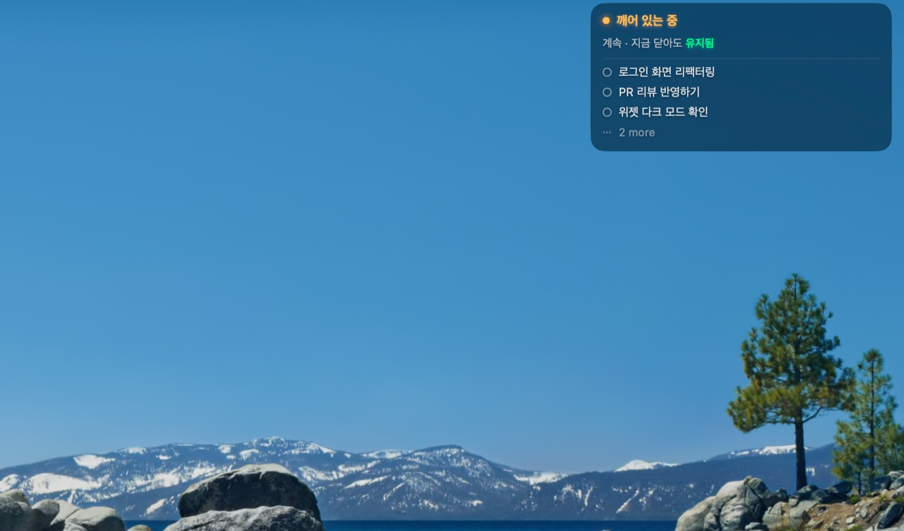
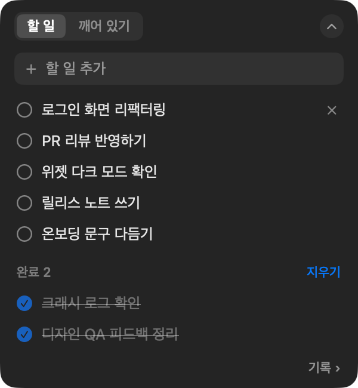
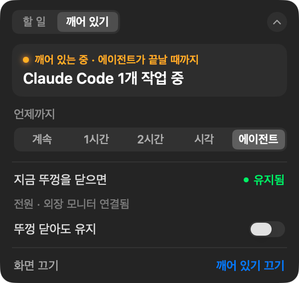
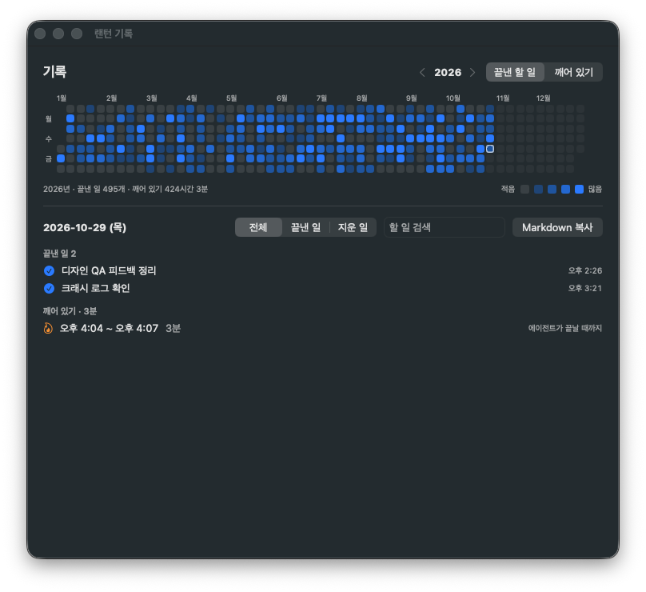

<p align="center">
  
</p>

<h1 align="center">랜턴 (Lantern)</h1>

<p align="center">
  할 일은 늘 보이게, 맥은 일이 끝날 때까지 깨어 있게.<br>
  화면 구석에 할 일을 늘 띄워 두고, Claude Code·Codex가 일하는 동안(또는 정한 시간까지) 맥을 깨워 두는 macOS 유틸리티입니다.
</p>

<p align="center">
  
</p>

---

## 할 수 있는 일

- **깨어 있기**: 정해 둔 시간 동안, 또는 Claude Code·Codex 같은 에이전트가 일을 마칠 때까지 맥이 잠들지 않게 합니다.
- **뚜껑 닫아도 유지**: 외장 모니터 없이 뚜껑을 닫아도 맥이 잠들지 않게 합니다. 배터리가 부족하거나 맥이 뜨거워지면 저절로 꺼집니다.
- **지금 닫으면 어떻게 되는지**: 지금 뚜껑을 닫으면 맥이 잠드는지 그대로 깨어 있는지 미리 알려 줍니다.
- **할 일**: 화면 오른쪽 위 작은 창에 할 일을 띄워 둡니다. 반투명해서 작업을 가리지 않고, 클릭은 뒤로 통과합니다.

<p align="center">
  
  &nbsp;
  
</p>

## 필요한 것

- macOS 26 이상
- Apple 실리콘(M1 이후) 맥. 인텔 맥은 지원하지 않습니다.
- 인터넷 연결은 필요 없습니다. 랜턴은 어떤 정보도 밖으로 보내지 않습니다.

## 설치

1. [Releases](../../releases) 페이지에서 가장 최근 `Lantern-x.y.z.dmg`를 받습니다.
2. dmg를 열고 **랜턴**을 **응용 프로그램** 폴더로 끌어 놓습니다.
3. 응용 프로그램 폴더에서 랜턴을 엽니다.

### 처음 열 때 "열 수 없음"이 나오면

랜턴은 아직 Apple 개발자 서명을 받지 않은 개인 프로젝트라서, 처음 열 때 macOS가 막습니다. 아래처럼 한 번만 허용하면 그다음부터는 바로 열립니다.

1. 랜턴을 한 번 열어 봅니다. "확인되지 않은 개발자" 또는 "열 수 없음" 안내가 뜨면 **완료**(또는 **취소**)를 누릅니다.
2. **시스템 설정 → 개인정보 보호 및 보안**으로 갑니다.
3. 아래쪽 **보안** 항목에 "랜턴이(가) 차단되었습니다"가 보이면 **그래도 열기**를 누릅니다.
4. 맥 암호를 입력하고, 다시 뜨는 안내에서 **열기**를 누릅니다.

> 이 과정이 불안하다면 이 저장소의 코드를 직접 확인하고 Xcode로 빌드해서 써도 됩니다.

> **지울 때는 앱만 휴지통에 넣지 말고 [지우기](#지우기)를 먼저 봐 주세요.** 뚜껑 닫아도 유지 권한(시스템 규칙 파일)과 에이전트 연결은 앱을 지워도 남기 때문에, 설정에서 먼저 정리해야 깔끔하게 지워집니다.

## 사용법

### 메뉴바 아이콘

| 아이콘 | 뜻 |
|---|---|
| 속이 빈 불꽃 | 깨어 있기 꺼짐 |
| 채운 불꽃 | 깨어 있는 중 |
| 양옆에 기둥이 있는 불꽃 | 뚜껑 닫아도 유지 중 |

- **왼쪽 클릭**: 오른쪽 위 창을 열고 닫습니다.
- **오른쪽 클릭**: 메뉴가 열립니다. 깨어 있기 시작·끄기, 언제까지, 연장, 창 숨기기, 설정, 종료가 있습니다.

> MacBook은 화면 위 가운데(노치) 때문에 메뉴바 공간이 좁아서, 아이콘이 많으면 랜턴 아이콘이 가려질 수 있습니다. **⌘를 누른 채 아이콘을 오른쪽으로 끌어** 시계 가까이에 두면 잘 보입니다. 가려져 있어도 아래 단축키로 창을 열 수 있습니다.

### 오른쪽 위 창

창은 세 가지 모양으로 보입니다.

- **활성 창**: 아이콘을 누르거나 단축키로 열었을 때입니다. 할 일과 깨어 있기를 조작할 수 있습니다. 창 밖을 누르거나 10초 동안 아무것도 하지 않으면 닫힙니다.
- **펼친 평소 창**: 활성 창을 닫으면 반투명한 창으로 남아, 깨어 있기 상태와 할 일 위에서 세 개를 보여 줍니다.
- **접힌 바**: 한 줄로 줄인 모양입니다. 깨어 있기 상태와 할 일 개수만 보여 줍니다.

<p align="center">
  
</p>

펼친 모양과 접힌 모양은 활성 창 오른쪽 위의 **⌃ / ⌄** 버튼으로 고릅니다. 창은 활성 창의 **위쪽 탭 줄을 끌어** 다른 모서리나 다른 모니터로 옮길 수 있고, 놓으면 가장 가까운 모서리에 붙습니다. 아래쪽 모서리에 두면 위로 펼쳐집니다. 평소 창 위에 마우스를 올리면 흐려져서 뒤가 보이고, 클릭은 뒤로 통과합니다.

### 단축키

| 단축키 | 하는 일 |
|---|---|
| ⌃⌥L | 창 열기·닫기 (아이콘 왼쪽 클릭과 같음) |
| ⌃⌥⇧L | 창 숨기기·보이기 |
| Esc | 열린 창 닫기 |

단축키는 **설정 → 일반 → 단축키**에서 바꾸거나 끌 수 있습니다. 단, **⌃ 또는 ⌥가 들어간 조합만** 쓸 수 있습니다. ⌘W·⌘C 같은 ⌘ 조합은 대부분 앱이 이미 쓰고 있어서, 랜턴이 전역 단축키로 가져가면 모든 앱에서 그 기능이 막히기 때문입니다.

### 깨어 있기

활성 창의 **깨어 있기** 탭에서 **언제까지**를 고르면 바로 시작합니다.

| 언제까지 | 뜻 |
|---|---|
| 계속 | 직접 끌 때까지 |
| 1시간 / 2시간 | 지금부터 그 시간 동안 |
| 시각 | 고른 시각까지 (이미 지난 시각이면 내일 그 시각) |
| 에이전트 | 연결한 에이전트가 일을 모두 마칠 때까지 ([에이전트 연결](#에이전트-연결) 참고) |

- **연장 ›**: 시간이 정해진 세션이면 끊지 않고 30분·1시간·2시간을 더할 수 있습니다.
- **화면 끄기**: 맥은 깨워 둔 채 화면만 바로 끕니다.
- 깨어 있기는 "가만히 두면 잠드는 것"만 막습니다. 뚜껑을 닫으면 원래대로 잠듭니다. 뚜껑을 닫아도 깨어 있게 하려면 아래 **뚜껑 닫아도 유지**를 켜세요.
- 충전기 없이 배터리가 **설정의 배터리 기준(기본 20%)** 아래로 내려가면 깨어 있기를 끕니다.

### 뚜껑 닫아도 유지

외장 모니터 없이 뚜껑을 닫아도 맥이 잠들지 않게 합니다. 깨어 있기가 켜져 있을 때만 켤 수 있습니다.

**처음 한 번 권한 설치가 필요합니다.** **설정 → 전원 → 뚜껑 닫아도 유지**에서 **설치…**를 누르고 맥 암호를 입력하세요.

설치하면 맥에 규칙 파일(`/etc/sudoers.d/lantern`)이 하나 생기고, 아래 세 명령만 암호 없이 실행할 수 있게 됩니다.

```
sudo /usr/bin/pmset -a disablesleep 1   # 잠자기 막기
sudo /usr/bin/pmset -a disablesleep 0   # 잠자기 되돌리기
sudo /usr/bin/pmset sleepnow            # 지금 재우기
```

- 이 규칙은 **이 맥의 다른 프로그램도 쓸 수 있습니다.** 다만 할 수 있는 일은 위 세 가지, 즉 잠들지 않게 하거나 재우는 것뿐입니다. 다른 명령은 여전히 암호가 필요합니다.
- 원치 않으면 같은 곳의 **제거…**로 언제든 지울 수 있습니다. **랜턴을 지울 때도 이 규칙 파일은 앱과 함께 사라지지 않으니, 먼저 제거…를 눌러 주세요.**

**저절로 꺼지는 경우**
- 깨어 있기가 끝날 때 (뚜껑이 닫혀 있었다면 맥을 바로 재웁니다)
- 충전기 없이 배터리가 기준 아래로 내려갈 때
- 맥이 많이 뜨거워질 때
- 랜턴을 종료할 때. 랜턴이 갑자기 꺼져도 작은 감시 작업이 5초 안에 원래대로 돌려 놓습니다.

> 감시 작업은 시스템 설정의 **로그인 항목 및 확장 프로그램 → 앱 백그라운드 활동**에 "랜턴 뚜껑 모드 감시"로 보입니다. 뚜껑 닫아도 유지가 켜져 있는 동안에만 생깁니다.

### 에이전트 연결

**설정 → 에이전트**에서 Claude Code와 Codex를 연결하면, 언제까지를 **에이전트**로 골랐을 때 에이전트가 일하는 동안만 깨어 있습니다.

- 연결하면 각 에이전트의 설정 파일(Claude Code `~/.claude/settings.json`, Codex `~/.codex/hooks.json`)에 랜턴 신호가 더해집니다. 다른 설정은 건드리지 않고, 바꾸기 전 파일을 같은 폴더에 `.lantern-backup`으로 남깁니다.
- **Codex**는 연결한 뒤 Codex를 다시 열고, 뜨는 **훅 검토**(또는 `/hooks`)에서 랜턴 항목을 허용해야 동작합니다.
- **Claude Code**는 처음 여는 폴더를 신뢰해야 신호가 옵니다.
- 연결이 잘 됐는지는 설정의 "마지막 신호"로 확인할 수 있습니다.

**언제 끝난 것으로 보나요?**
- 일하는 에이전트가 모두 끝나면 1분 뒤 깨어 있기를 끕니다. 그 사이 다음 지시를 내리면 이어집니다.
- 명령이 실행 중이면 신호가 없어도 최대 3시간까지 기다립니다.
- 그 밖에 30분 동안 신호가 없으면 끝난 것으로 봅니다. 예: Esc로 작업을 중단한 경우
- 에이전트 프로그램을 닫으면 바로 끝난 것으로 봅니다.
- 에이전트를 골랐는데 30분 동안 아무 에이전트도 일을 시작하지 않으면 끕니다.

### 할 일

- 활성 창의 **할 일** 탭에서 **할 일 추가**에 적고 Enter를 누르면 목록 맨 아래에 붙습니다.
- 동그라미를 누르면 끝낸 것으로 표시되어 **완료** 묶음으로 내려갑니다. 다시 누르면 되돌아옵니다. **지우기**를 누르면 완료한 것만 지워집니다. 지운 할 일도 기록에는 남습니다.
- 끌어서 순서를 바꿀 수 있습니다. 위에서 세 개가 평소 창에 보입니다.
- 더블클릭하면 이름을 고칠 수 있고, 마우스를 올리면 나오는 ×로 지울 수 있습니다.
- 할 일은 이 맥에만 저장됩니다.

### 기록

메뉴바 아이콘 오른쪽 클릭 → **기록 보기…**, 또는 할 일 탭 아래의 **기록 ›**

<p align="center">
  
</p>

- 위쪽 **잔디**에서 한 해 동안 날짜별로 얼마나 했는지 한눈에 봅니다. **‹ ›**로 지난해를 넘겨 볼 수 있습니다. 색 기준은 **끝낸 할 일** 또는 **깨어 있기**(깨어 있던 시간) 중에서 고릅니다.
- 칸을 누르면 아래에 그날의 **끝낸 일 · 지운 일 · 깨어 있기**가 나옵니다.
- **전체 / 끝낸 일 / 지운 일**로 거르거나, 할 일 제목으로 검색할 수 있습니다.
- **Markdown 복사**를 누르면 그날 기록이 체크리스트 모양으로 복사됩니다. Obsidian이나 Notion에 그대로 붙여 넣을 수 있습니다.

### 설정

메뉴바 아이콘 오른쪽 클릭 → **설정…**

| 탭 | 내용 |
|---|---|
| 일반 | 로그인할 때 열기, 단축키 |
| 에이전트 | Claude Code·Codex 연결 |
| 전원 | 배터리 기준, 뚜껑 닫아도 유지 권한 |

## 지우기

깔끔하게 지우려면 **앱을 지우기 전에** 설정에서 아래 두 가지를 먼저 해 주세요.

1. **설정 → 전원 → 뚜껑 닫아도 유지 → 제거…** (권한 규칙 파일 삭제)
2. **설정 → 에이전트 → 해제** (연결한 에이전트마다)

그다음 응용 프로그램 폴더에서 랜턴을 휴지통으로 옮기면 됩니다.

### 앱을 먼저 지웠다면

터미널에서 아래 명령으로 직접 정리할 수 있습니다.

```bash
# 뚜껑 닫아도 유지 권한 규칙 지우기 (맥 암호 필요)
sudo rm /etc/sudoers.d/lantern
# 혹시 켜져 있다면 잠자기 되돌리기
sudo pmset -a disablesleep 0
# 랜턴이 남긴 파일(할 일, 신호 기록 등) 지우기
rm -rf ~/Library/Application\ Support/Lantern
rm -f ~/Library/LaunchAgents/com.songkyuseob.lantern.watchdog.plist
```

에이전트 설정에 남은 랜턴 신호는 앱을 지운 뒤에도 에이전트가 일할 때마다 작은 기록 파일을 남깁니다(무슨 일이 일어났는지만 적고, 대화 내용은 적지 않으며, 2,000개가 넘으면 더 쓰지 않습니다). 위의 `rm -rf ~/Library/Application\ Support/Lantern`으로 폴더를 지웠다면 아무 일도 하지 않습니다. 설정에서도 깔끔하게 빼고 싶다면 `~/.claude/settings.json`, `~/.codex/hooks.json`에서 `lantern-agent-hook`이 들어 있는 항목을 지우거나, 같은 폴더의 `.lantern-backup` 파일로 되돌리면 됩니다. 단, 백업 파일은 연결하기 전 내용이라 그 뒤에 바꾼 설정은 사라집니다.

## 라이선스

[MIT](LICENSE)
